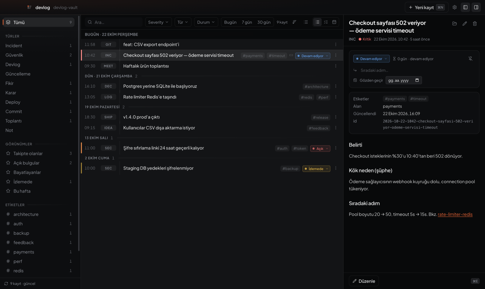
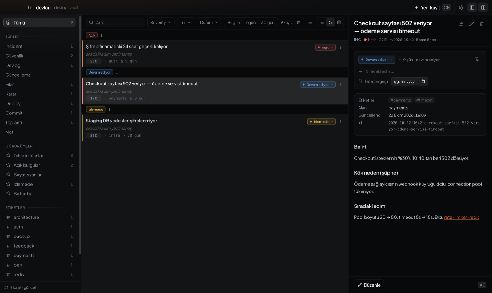

# devlog

**Ürün geliştirirken tutulan, yerel çalışan bir seyir defteri. Hem sen yazarsın hem de AI kodlama ajanın.**

devlog, bir şey inşa ederken olanları tarihleriyle kaydeder: incident'lar,
kararlar, güvenlik bulguları, deploy'lar, commit'ler, fikirler. Her kayıt
diskinde duran düz bir markdown dosyasıdır. Masaüstü uygulaması, CLI ve MCP
sunucusu aynı dosyaları okuyup yazar. Böylece Claude Code (ya da MCP destekleyen
herhangi bir ajan) defteri arayabilir ve deftere kendisi de yazabilir.

> 🇬🇧 English: [README.md](README.md)



---

## Hangi problemi çözüyor?

Ürün geliştirirken en çok ihtiyaç duyduğun bilgi, unutan yerlere dağılmış durumda:

- **"Bunu neden böyle yapmıştık?"** Karar bir sohbette, bir toplantıda ya da
  artık var olmayan bir AI oturumunda verildi.
- **"Bu sorun ne zaman başladı?"** Olayın zaman çizelgesi kafanda ve dağınık
  commit mesajlarında duruyor.
- **"O güvenlik açığı gerçekten kapandı mı?"** Altı hafta önce "neredeyse
  bitti" denmişti ve o günden beri kimse bakmadı.
- **AI kodlama ajanları bu sorunu büyütüyor.** Gerçek işin büyük kısmı artık
  ajan oturumlarında yapılıyor. Oturum kapanınca bağlamı kayboluyor ve sonraki
  oturum geçen haftanın kararlarından habersiz başlıyor.

Issue tracker planlanan iş içindir, wiki ise zamanla eskir. İkisi de *gerçekte
ne olduğunu, sırasıyla* zahmetsizce kaydetmez.

devlog bu kaydı tutar:

| | |
|---|---|
| **Otomatik kayıt** | Commit'ler, deploy'lar ve Claude Code oturum özetleri hook'larla deftere düşer. Ek model çağrısı yapılmaz. |
| **2 saniyelik elle kayıt** | Global kısayol tek satırlık bir giriş penceresi açar: `Login 500 dönüyor /incident !high @api #auth` |
| **Açık kalanları gösterir** | Durum, *sıradaki adım*, gözden geçirme tarihi ve **bayatlık**: 14 günden uzun süredir açık duran bir iş unutulmaz, işaretlenir. |
| **Ajan okuyabilir** | MCP sunucusu sayesinde ajan "temmuzda ödeme servisinde ne oldu?" sorusunu cevaplayabilir ve kararları kendisi kaydedebilir. |
| **Veri senin** | Senin klasöründe düz markdown + YAML (tercihen bir git deposu). Hesap yok, bulut yok, telemetri yok. Arama indeksi dosyalardan yeniden kurulur; hiçbir veri yalnızca indekste durmaz. |
| **Sırları dışarıda tutar** | Otomatik yazılan her kayıt maskeleyiciden geçer (JWT, özel anahtar, bulut/API token'ları, imzalı URL'ler, `*_SECRET=` …). CLI, sır içeren bir elle kaydı `--redact` ya da `--allow-secrets` verilmedikçe kaydetmez. |



---

## Kurulum

### Seçenek A: uygulamayı indir (macOS / Windows)

En son sürüm **[Releases](../../releases)** sayfasında:

- **macOS**: `Devlog-<sürüm>-arm64.dmg` (Apple Silicon) ya da `-x64.dmg` (Intel)
- **Windows**: `Devlog-<sürüm>-setup.exe` (kurulum) ya da taşınabilir `.exe`

Paketler **imzalı değil** (ücretli Apple/Microsoft sertifikası yok). Bu yüzden
işletim sistemi ilk açılışta uyarı verir:

- **macOS**: uygulamaya sağ tıkla → **Aç** → **Aç**. "Hasarlı" uyarısı
  alırsan indirme karantina bayrağını kaldır:
  `xattr -dr com.apple.quarantine /Applications/Devlog.app`
- **Windows**: SmartScreen → **Ek bilgi** → **Yine de çalıştır**

Hazır bir paketi çalıştırmak istemiyorsan kaynaktan derle (Seçenek B). Kodun
tamamı bu repoda.

### Seçenek B: kaynaktan

Gereksinimler: **Node 22+** ve **pnpm 10+** (`corepack enable` ile pnpm gelir).

```bash
git clone https://github.com/ReCreatedOS/devlog-app.git
cd devlog-app
pnpm install
pnpm build:tools     # CLI, Claude Code hook'ları, MCP sunucusu → apps/*/dist
pnpm dev             # masaüstü uygulamasını geliştirme kipinde aç
```

Masaüstü paketini üretmek için:

```bash
pnpm dist:mac        # → apps/desktop/release/*.dmg, *.zip
pnpm dist:win        # → apps/desktop/release/*.exe
```

Electron ikilisi ilk çalıştırmada iner. Uygulamayı **VS Code'un entegre
terminalinden** başlatıyorsan ve hiçbir şey olmuyorsa, sebebi VS Code'un
`ELECTRON_RUN_AS_NODE=1` ayarlamasıdır. `env -u ELECTRON_RUN_AS_NODE pnpm dev`
ile başlat.

### `devlog` komutunu PATH'e ekle (isteğe bağlı)

```bash
cd apps/cli && npm link     # artık her terminalde `devlog` çalışır
```

Bunu yapmazsan `node <repo>/apps/cli/dist/devlog.mjs` ile çağırabilirsin.

---

## Hızlı başlangıç

İlk çalıştırmada **`~/devlog-vault`** oluşturulur:

```
devlog-vault/
├── CLAUDE.md / AGENTS.md   ← vault'ta çalışan AI ajanları için biçim rehberi
├── taxonomy.yaml           ← izin verilen tür, severity ve durum değerleri
├── entries/2026/10/2026-10-22-1042-checkout-502-veriyor.md
└── tracking/               ← salt-okunur kaynaklar için durum katmanı (aşağıda)
```

Vault'u bir git deposu yapmanı öneririz (`cd ~/devlog-vault && git init`). O
zaman "bu ne zaman değişti?" sorusunun cevabı `git log`'da olur. Vault'u
**gizli** tut: güvenlik bulguları ve prod ayrıntıları içerebilir.

Başka bir konum kullanmak için `~/.devlog/config.json` içindeki `vaultRoot`
değerini değiştir (`~` açılır) ya da `DEVLOG_VAULT` ortam değişkenini ayarla.

### Masaüstü uygulaması

Üç panel var: gezinme, zaman akışı ve kayıt detayı. Orta panelin her biri ayrı
bir soruyu cevaplayan üç kipi vardır:

| Kip | Soru | Sıralama |
|---|---|---|
| **Liste** | *Ne oldu?* | zaman |
| **Takip** | *Ne açık duruyor?* | aciliyet: gözden geçirme günü → bayatlık → severity → yaş |
| **Takvim** | *Ne zaman?* | günlük ısı haritası |

Düzenleme yerinde yapılır (`⌘E`, kaydetmek için `⌘S`). Sen düzenlerken bir ajan
aynı dosyaya yazarsa devlog üzerine yazmaz, seni uyarır. Ayarlar (`⌘,`): 13
tema, vurgu rengi, yerleşim, bayatlık eşikleri, aynalanan kaynaklar ve global
kısayol.

**Hızlı yakalama** (macOS'ta `⌥Space`, Windows'ta `Ctrl+Alt+Space`, her yerden
açılır):

```
Checkout 502 veriyor /incident !kritik @payments #timeout
Kök neden: connection pool tükendi.        ← sonraki satırlar gövde olur
```

`/tür` `!severity` `@alan` `#etiket`. İlk satır başlık olur. Tanınmayan bir
`/token` metinde kalır, bu yüzden `/usr/local` gibi yollar yutulmaz. Türkçe
takma adlar da çalışır: `/guvenlik`, `/fikir`, `/karar`, `!kritik`.

| Kısayol | |
|---|---|
| `⌘N` / `⌘⇧N` | yeni kayıt / hızlı yakalama |
| `/` | aramaya odaklan |
| `j` `k` ya da `↑` `↓` | listede gezin |
| `1`–`5` | durum: açık · devam ediyor · bloke · izlemede · düzeltildi |
| `g d` | bugüne git |
| `⌘\` / `⌘/` | sol / sağ paneli aç-kapat |
| `⌘⇧R` | yeniden indeksle |

### CLI

```bash
devlog new --title "MVP için SQLite'a geçtik" --type decision --body "DB sunucusunun operasyon yükü…"
devlog capture "Şifre sıfırlama linki 24 saat geçerli /guvenlik !high @auth"
devlog list --since 7d --type security
devlog list --stale                       # uzun süredir kimsenin dokunmadığı açık işler
devlog search "connection pool" --json
devlog show <id>
echo "Fix deploy edildi, izleniyor." | devlog append <id> --body -
devlog status <id> monitoring --next "Cuma günü hata oranına bak" --review 2026-11-01
devlog timeline --day 2026-10-22
devlog doctor                             # config, vault, hook'lar: sorun ne?
```

Tüm okuma komutları `--json` alır. Tam liste için: `devlog help`.

---

## Claude Code entegrasyonu

devlog'un en işe yaradığı yer burası: Claude ile yaptığın işler sen bir şey
yapmadan deftere geçer.

```bash
pnpm build:tools
pnpm setup:claude                  # hook'ları ekle + MCP sunucusunu kaydet
pnpm setup:claude --stop-reminder  # …ve isteğe bağlı tur sonu hatırlatıcısı
devlog doctor                      # her şeyin bağlı olduğunu doğrula
```

`setup:claude`, `~/.claude/settings.json` dosyasını değiştirmeden önce
yedekler ve tekrar çalıştırılması güvenlidir. Değişiklikleri önce görmek için
`--dry-run` kullan.

### Ne elde edersin?

**1. Commit ve deploy'lar (`PostToolUse` hook'u).** Claude'un çalıştırdığı her
`git commit` bir kayda dönüşür: SHA, konu, tam mesaj, değişen dosyalar ve dal.
Kaydın tarihi, yazıldığı an değil commit'in kendi zamanıdır. Başarısız commit'ler
yok sayılır, `--amend` var olan kaydı günceller. Deploy komutları
(`wrangler deploy`, `vercel --prod`, `fly deploy`, `supabase functions deploy`,
`npm run deploy`) çıktılarının maskelenmiş son satırlarıyla kaydedilir.

**2. Oturum özeti (`SessionEnd` hook'u).** Bir şey değiştiren (dosya düzenleyen
ya da commit atan) her oturum için tek kayıt yazılır. Başlık Claude Code'un
kendi oturum başlığından gelir. Gövdede promptların, dokunulan dosyalar ve
commit'ler yer alır. Ek model çağrısı yapılmaz. `DEVLOG_SESSION_LOG=all` ile
yalnız soru-cevaptan oluşan oturumlar da yazılır, `off` ile hiçbiri yazılmaz.

**3. MCP sunucusu: kararı ajan verir.** Altı araç var: `devlog_search`,
`devlog_get`, `devlog_create`, `devlog_append`, `devlog_update_status` ve
`devlog_timeline`. Herhangi bir projeden *"bu kararı deftere yaz"* diyebilir ya
da *"auth tarafında açık ne var?"* diye sorabilirsin.

**4. Stop hatırlatıcısı (isteğe bağlı, `jq` gerekir).** Oturum başına en fazla
bir kez, kayda değer bir turdan sonra Claude'a kalıcı değeri olan bir şey olup
olmadığı sorulur. Olduysa ajan özenle yazılmış bir kayıt bırakır, olmadıysa
hiçbir şey söylemez.

**Geçmiş oturumları aktarmak:** hook'lar yalnızca kurulumdan sonraki oturumları
görür. Daha eskilerini içeri almak için:

```bash
devlog backfill --dry-run
devlog backfill
devlog backfill --all --since 2026-09-01
```

Bu komut aynı oturumu iki kez yazmaz (oturum id'sine göre tekilleştirir), yani
istediğin kadar çalıştırabilirsin.

### Claude memory aynaları

devlog, Claude Code'un proje hafıza klasörlerini (`~/.claude/projects/*/memory`)
bulur ve **salt-okunur** kaynaklar olarak gösterir. Onlara tek bayt yazmaz. Yine
de bu notlara durum, sıradaki adım ve gözden geçirme tarihi verebilirsin: bu
katman senin vault'unda, `tracking/` altında saklanır. İstemediğin kaynakları
Ayarlar'dan kapatabilirsin.

---

## Ayarlar

| | |
|---|---|
| `~/.devlog/config.json` | vault konumu, kaynaklar, kısayol, tema, bayatlık eşikleri; tüm araçlar bu dosyayı paylaşır |
| `DEVLOG_VAULT` | vault yolunu ezer |
| `DEVLOG_CONFIG` | config dosyasının yolunu ezer |
| `DEVLOG_HOOKS=off` | Claude Code hook'larını kaldırmadan kapatır |
| `DEVLOG_SESSION_LOG` | `all` · `off` (varsayılan: yalnız bir şey değiştiren oturumlar) |

Kayıt biçimi, mimari ve geliştirme notları için İngilizce
[README](README.md#entry-format)'ye bak.

## Bilinen sınırlar

- Masaüstü arayüzü **yalnızca Türkçe**.
- Paketler imzasız (bkz. [Kurulum](#kurulum)).
- Linux masaüstü paketi üretilmiyor ve test edilmedi. CLI ve MCP sunucusu
  Linux'ta çalışır.

## Lisans

[MIT](LICENSE)
